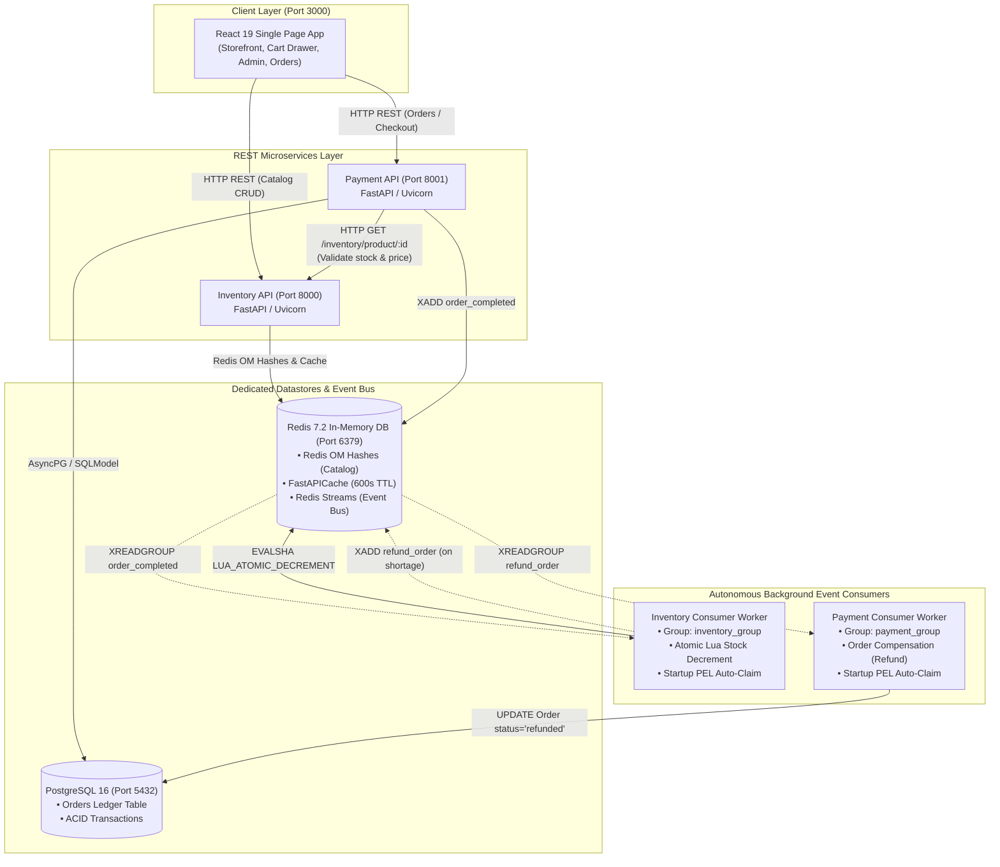
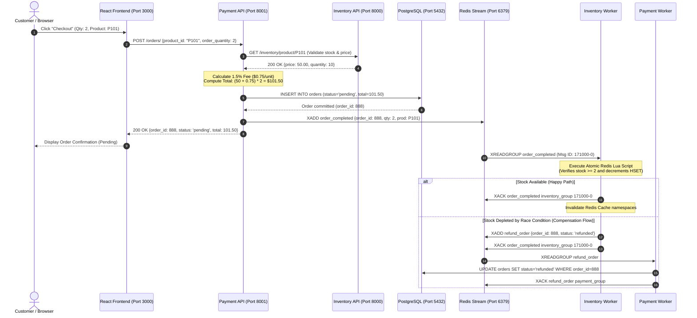

<div align="center">

# ⚡ Inventory Order System

### _Event-Driven Distributed Microservices E-Commerce Platform_

[-success?style=for-the-badge&logo=pytest&logoColor=white>)](#-testing--quality-assurance)
[](https://fastapi.tiangolo.com)
[](https://www.python.org/)
[](https://www.postgresql.org/)
[](https://redis.io/)
[](https://react.dev/)
[](https://vitejs.dev/)
[](https://www.docker.com/)
[](./LICENSE)

<p align="center">
  A high-throughput, event-driven e-commerce microservices platform demonstrating <b>domain decomposition</b>, <b>asynchronous choreography sagas</b>, <b>atomic Lua stock decrements</b>, <b>Redis Streams message brokering</b>, and a responsive <b>React 19 storefront</b>.
</p>

[Architecture](#-system-architecture--service-topology) •
[Data Flow & Saga](#-choreography-saga--event-driven-lifecycle) •
[Workflows & Quickstart](#-workflows--quickstart-guide) •
[API Reference](#-api-endpoints-reference) •
[Testing & QA](#-testing--quality-assurance) •
[Documentation](#-technical-documentation)

---

</div>

## 📖 Executive Summary

Modern e-commerce platforms require ultra-low latency for browsing massive product catalogs while strictly maintaining transactional consistency and zero overselling during high-concurrency burst events (e.g. flash sales).

**Inventory Order System** solves this challenge through clear service boundary isolation and asynchronous event choreography:

1. **Inventory Service (Port 8000)**: Optimized for blazing-fast catalog reads. Backed by **Redis OM HashModels** and **FastAPICache** (Cache-Aside, 600s TTL). Pipelined batch queries eliminate $N+1$ roundtrip latency.
2. **Payment Service (Port 8001)**: Governs order creation, 1.5% platform fee calculations (with 5% included GST pricing breakdown), and transaction records. Backed by **PostgreSQL 16** via **SQLModel** with async connection pooling (`asyncpg`).
3. **Redis Event Bus (Port 6379)**: Provides decoupled, asynchronous pub/sub messaging via **Redis Streams** (`order_completed` and `refund_order`) with persistent consumer groups.
4. **Autonomous Stream Workers**: Background daemon workers consume stream events, execute concurrency-safe **Redis Lua scripts** (`LUA_ATOMIC_DECREMENT`) to guarantee zero race-condition overselling, and autonomously recover pending messages on startup via **Pending Entries List (PEL)** auto-claim.
5. **Customer & Admin Storefront (Port 3000)**: A modern **React 19** single-page application built with **Vite** and **Bootstrap 5**, featuring a live catalog grid, offcanvas cart drawer, admin inventory CRUD, order lifecycle tracking, and global React `ErrorBoundary` safety.

---

## 🏛️ System Architecture & Service Topology



### Container Topology & Port Allocation

| Component            | Container Name                       | Host Port | Internal Port | Technology           | Purpose                                           |
| :------------------- | :----------------------------------- | :-------: | :-----------: | :------------------- | :------------------------------------------------ |
| **Frontend SPA**     | `inventory-order-frontend`           |  `3000`   |    `3000`     | React 19 / Vite      | Storefront, cart, admin CRUD, order history       |
| **Inventory API**    | `inventory-order-inventory-api`      |  `8000`   |    `8000`     | FastAPI / Uvicorn    | Catalog management, Redis OM, FastAPICache        |
| **Payment API**      | `inventory-order-payment-api`        |  `8001`   |    `8001`     | FastAPI / Uvicorn    | Order creation, fee calculation, stream publisher |
| **Inventory Worker** | `inventory-order-inventory-consumer` |     —     |       —       | Python / Redis TCP   | Atomic Lua stock decrement, stream ACK            |
| **Payment Worker**   | `inventory-order-payment-consumer`   |     —     |       —       | Python / SQLModel    | Refund compensation handler                       |
| **Redis Event Bus**  | `inventory-order-redis`              |  `6379`   |    `6379`     | Redis 7.2 Alpine     | Catalog storage, API caching, event streams       |
| **PostgreSQL DB**    | `inventory-order-postgres`           |  `5432`   |    `5432`     | PostgreSQL 16 Alpine | Relational orders ledger, ACID persistence        |

---

## 🔄 Choreography Saga & Event-Driven Lifecycle

The platform uses a distributed **Choreography Saga** to decouple orders from catalog mutations while guaranteeing eventual consistency:



### Why Atomic Lua Scripting Matters

In high-throughput environments, standard Python read-then-write loops (`product.quantity -= qty; product.save()`) suffer from race conditions that cause overselling. Fast-Cart executes an atomic Lua script directly inside Redis's single-threaded command processor:

1. Validates product existence (`HEXISTS`).
2. Checks stock adequacy (`current_qty >= order_qty`).
3. Decrements and persists atomically (`HSET`).
4. Returns exact exit codes: `1` (Success), `0` (Missing item), `-2` (Shortage).

---

## 📂 Repository Architecture

```
inventory-order-system/
├── .github/
│   └── workflows/
│       └── ci.yml                  # GitHub Actions CI (linting, tests, build)
├── backend/
│   ├── inventory/                  # Inventory Catalog Microservice (Port 8000)
│   │   ├── app/
│   │   │   ├── db/redis.py         # Redis OM & FastAPICache connection pool
│   │   │   ├── exceptions/         # Custom exception hierarchy (404s)
│   │   │   ├── models/models.py    # Redis OM Product HashModel & input schemas
│   │   │   ├── routes/route.py     # Product CRUD REST endpoints & /health
│   │   │   ├── services/           # Pipelined batching & cache invalidation
│   │   │   ├── workers/consumer.py # Redis Stream consumer with atomic Lua decrement
│   │   │   └── main.py             # FastAPI entrypoint, lifespan context & CORS
│   │   ├── .dockerignore           # Container build exclusions
│   │   ├── Dockerfile              # Inventory microservice container
│   │   └── requirements.txt        # Pinned service dependencies
│   └── payment/                    # Payment & Orders Microservice (Port 8001)
│       ├── app/
│       │   ├── db/postgresql.py    # AsyncPG engine, SQLModel session dependency
│       │   ├── db/redis_stream.py  # Redis Stream client connection
│       │   ├── models/models.py    # SQLModel Order table & Pydantic request models
│       │   ├── routes/route.py     # Order lifecycle endpoints & /health
│       │   ├── services/           # 1.5% platform fee calc, stock check, SQL .returning()
│       │   ├── workers/consumer.py # Asynchronous refund compensation consumer
│       │   └── main.py             # FastAPI entrypoint, lifespan context & CORS
│       ├── .dockerignore           # Container build exclusions
│       ├── Dockerfile              # Payment microservice container
│       └── requirements.txt        # Pinned service dependencies
├── frontend/                       # React 19 + Vite Single Page Application (Port 3000)
│   ├── src/
│   │   ├── api/client.js           # Centralized dual-service API client (8000 & 8001)
│   │   ├── components/             # Storefront, cart drawer, admin CRUD, orders, 404
│   │   ├── context/CartContext.jsx # Shopping cart state with localStorage persistence
│   │   ├── utils/formatters.js     # Currency, date, and fee formatting utilities
│   │   ├── App.jsx                 # Client-side routing configuration
│   │   ├── index.css               # Clean styling (Bootstrap 5.3 + custom theme)
│   │   └── main.jsx                # Application root with React Error Boundary
│   ├── .dockerignore               # Container build exclusions
│   ├── Dockerfile                  # Vite development container
│   ├── package.json                # React 19, React Router 7, Bootstrap 5 dependencies
│   └── vite.config.js              # Vite server configuration (host 0.0.0.0, port 3000)
├── tests/                          # 4-Tier Automated Test Suite (64 Passing Tests)
│   ├── unit/                       # CRUD, 1.5% fee calc, boundaries, input validation
│   ├── integration/                # Inter-service flows & Redis Stream worker processing
│   ├── e2e/                        # Full shopping journey, concurrency stress & PEL
│   ├── conftest.py                 # Isolated test fixtures (fakeredis, MockAsyncSession)
│   ├── test_inventory_route.py     # Refactored inventory route tests
│   └── test_payment_route.py       # Refactored payment route tests
├── docs/                           # Centralized Technical Documentation
│   ├── ARCHITECTURE.md             # System architecture and Mermaid flow diagrams
│   ├── API.md                      # Inventory and payment REST endpoint reference
│   ├── SETUP.md                    # Local run and offline setup instructions
│   ├── TESTING.md                  # Test suite documentation & tier breakdown
│   └── DEPLOYMENT.md               # Production requirements & limitations
├── .dockerignore                   # Monorepo container build exclusions
├── .env.example                    # Exhaustive environment variable configuration
├── docker-compose.yml              # 7-service orchestration with healthchecks
├── Dockerfile                      # Reference monorepo container image
├── LICENSE                         # MIT License
├── package.json                    # Workspace root
├── package-lock.json               # Root lockfile
└── requirements.txt                # Unified Python dependencies (runtime & testing)
```

---

## 🚀 Workflows & Quickstart Guide

### Workflow 1: 1-Click Docker Compose (Recommended)

Docker Compose orchestrates all 7 services with automated container healthcheck probes (`condition: service_healthy`) ensuring databases are operational before APIs and workers launch.

```bash
# 1. Clone the repository
git clone https://github.com/HariChandran7177-git/inventory-order-system.git
cd inventory-order-system

# 2. Copy the environment template
cp .env.example .env

# 3. Start all services
docker compose up --build -d

# 4. Check service health
docker compose ps
```

#### Application Endpoints

- 🛒 **Customer Storefront**: [http://localhost:3000](http://localhost:3000)
- 📦 **Admin Inventory Manager**: [http://localhost:3000/admin](http://localhost:3000/admin)
- 📋 **Order History & Tracking**: [http://localhost:3000/orders](http://localhost:3000/orders)
- 📑 **Inventory API Swagger UI**: [http://localhost:8000/docs](http://localhost:8000/docs)
- 📑 **Payment API Swagger UI**: [http://localhost:8001/docs](http://localhost:8001/docs)

```bash
# View live streaming logs
docker compose logs -f

# Stop all services
docker compose down
```

---

### Workflow 2: Native Local Development (Offline Mode)

For local development without Docker:

```bash
# 1. Setup Python Virtual Environment
python -m venv .venv
.\.venv\Scripts\activate   # Linux/macOS: source .venv/bin/activate

# 2. Install Dependencies
pip install -r requirements.txt
pip install -r requirements-testing.txt

# 3. Launch Services (Separate Terminals)
# Terminal 1: Inventory API
uvicorn inventory.app.main:app --reload --port 8000

# Terminal 2: Inventory Consumer Worker
python -m inventory.app.workers.consumer

# Terminal 3: Payment API
uvicorn payment.app.main:app --reload --port 8001

# Terminal 4: Payment Consumer Worker
python -m payment.app.workers.consumer

# Terminal 5: Frontend Vite Server
npm --workspace=frontend run dev
```

---

## 📡 API Endpoints Reference

### 1. Inventory Service (Port 8000)

|  Method  | Endpoint                  | Description                     | Cache Strategy                                   |
| :------: | :------------------------ | :------------------------------ | :----------------------------------------------- |
|  `GET`   | `/health`                 | Service health probe            | None                                             |
|  `GET`   | `/inventory/products`     | Retrieve all catalog products   | FastAPICache (600s TTL, Redis pipeline batching) |
|  `GET`   | `/inventory/product/{pk}` | Retrieve single product details | FastAPICache (`inventory.product:{pk}`)          |
|  `POST`  | `/inventory/product`      | Create a new catalog product    | Invalidation (`inventory.products`)              |
|  `PUT`   | `/inventory/product/{pk}` | Update price or stock quantity  | Invalidation (item & list namespaces)            |
| `DELETE` | `/inventory/product/{pk}` | Delete product from catalog     | Invalidation (item & list namespaces)            |

#### Create Product Example

```bash
curl -X POST http://localhost:8000/inventory/product \
  -H "Content-Type: application/json" \
  -d '{"name": "Mechanical Keyboard RGB", "price": 129.99, "quantity": 25}'
```

---

### 2. Payment Service (Port 8001)

|  Method  | Endpoint             | Description                     | Processing Flow                                                                                |
| :------: | :------------------- | :------------------------------ | :--------------------------------------------------------------------------------------------- |
|  `GET`   | `/health`            | Service health probe            | None                                                                                           |
|  `GET`   | `/orders/`           | List all orders from PostgreSQL | SQLModel query ordered by ID                                                                   |
|  `GET`   | `/orders/{order_id}` | Retrieve single order details   | Clean 404 if missing                                                                           |
|  `POST`  | `/orders/`           | Place a new order               | Inventory HTTP check $\rightarrow$ 1.5% Fee $\rightarrow$ PostgreSQL $\rightarrow$ Redis Stream |
|  `PUT`   | `/orders/{order_id}` | Update order status or total    | Single atomic SQL `.returning(Order)`                                                          |
| `DELETE` | `/orders/{order_id}` | Delete order record             | PostgreSQL DELETE                                                                              |

#### Place Order Example

```bash
curl -X POST http://localhost:8001/orders/ \
  -H "Content-Type: application/json" \
  -d '{"product_id": "01JBMX9Q3Y4ABCDEF123456789", "order_quantity": 2}'
```

_For complete schema specifications and request/response payloads, see [docs/API.md](./docs/API.md)._

---

## 🧪 Testing & Quality Assurance

Inventory Order System features an automated **4-Tier Test Architecture** executed via `pytest`. Tests run **100% offline and isolated** using `fakeredis` with the `lupa` Lua engine and `MockAsyncSession` for PostgreSQL.

### 4-Tier Test Pyramid

```
                ▲
               / \     Tier 4: Real-World Scenarios (7 Tests)
              /   \    Full shopping journey, flash sale concurrency, PEL auto-claim
             /-----\
            /       \   Tier 3: Cross-Feature Workflows (11 Tests)
           /         \  Inter-service validation, saga refund events, Lua stock decrements
          /-----------\
         /             \ Tier 2: Boundary & Corner Cases (14 Tests)
        /               \ Quantities <= 0, negative prices, blank names, 404/422 guards
       /-----------------\
      /                   \ Tier 1: Feature Coverage (32 Tests)
     /                     \ Product CRUD, Order lifecycle, 20% unit fee calc, /health
    /-----------------------\
```

### Running Test Suites

```bash
# Run all 64 automated backend tests
pytest -q
# Result: 64 passed in 0.84s (100% pass rate)

# Run frontend ESLint code quality
npm --workspace=frontend run lint
# Result: 0 errors, 0 warnings

# Run frontend production bundle build
npm run build:frontend
# Result: Built cleanly in 1.35s
```

---

## 📊 Current Project Status & Readiness

| Quality Metric                |       Status       | Assessment                                                                     |
| :---------------------------- | :----------------: | :----------------------------------------------------------------------------- |
| **Backend Test Suite**        |  `64 / 64 Passed`  | 100% pass rate across all 4 tiers without live external daemons.               |
| **Frontend Code Quality**     |    `0 Warnings`    | Clean ESLint across all React 19 components and hooks.                         |
| **Frontend Production Build** |  `Passed (1.35s)`  | Optimized Vite bundle with local Bootstrap 5.3 & Icons.                        |
| **Container Orchestration**   | `Valid (0 Errors)` | Validated `docker-compose.yml` with healthchecks and dependencies.             |
| **Concurrency & Integrity**   | `Zero Overselling` | Concurrency-safe atomic Lua decrement and startup PEL recovery.                |
| **Production Readiness**      |  `Staging Ready`   | Ready for demo, portfolio, and staging. Requires JWT auth for public exposure. |

---

## 📚 Technical Documentation

Comprehensive architectural and engineering guides are available in the [`docs/`](./docs) directory:

- 🏛️ [**System Architecture & Topology**](./docs/ARCHITECTURE.md) — Detailed service map, data boundaries, and Mermaid sequence diagrams.
- 📡 [**REST API Documentation**](./docs/API.md) — Full request/response schemas, path parameters, and status codes.
- ⚙️ [**Local Setup & Runbook**](./docs/SETUP.md) — Environment variables, native installation, and troubleshooting.
- 🧪 [**Testing Guide**](./docs/TESTING.md) — 4-tier testing pyramid specification and mock execution.
- 🚢 [**Deployment Guide**](./docs/DEPLOYMENT.md) — Production requirements, connection pooling, and security hardening.

---

## 📄 License

This project is licensed under the [MIT License](./LICENSE). Open source and ready for portfolio showcase and technical interview defense.
