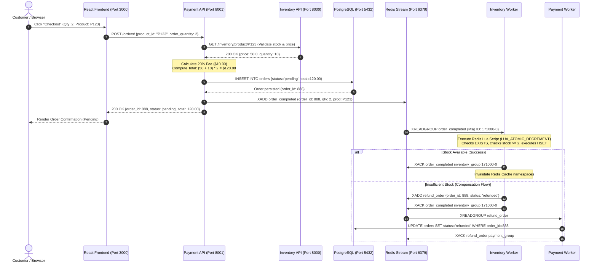

<div align="center">

# ⚡ Fast-Cart

### *High-Throughput, Event-Driven Microservices E-Commerce Platform*

[](https://fastapi.tiangolo.com)
[](https://www.python.org/)
[](https://www.postgresql.org/)
[](https://redis.io/)
[](https://react.dev/)
[](https://vitejs.dev/)
[](https://www.docker.com/)
[-brightgreen?style=for-the-badge&logo=pytest&logoColor=white)](./tests)
[](./LICENSE)

<p align="center">
  <b>Fast-Cart</b> is a production-engineered, asynchronous, event-driven e-commerce platform decoupling catalog inventory and payment order processing into distributed microservices. Engineered with an event-driven choreography Saga pattern, atomic Redis Lua script stock operations, multi-tier caching with pipeline batch loading, and a modern React 19 storefront.
</p>

[System Architecture](#-system-architecture--topology) •
[Data Flow & Saga](#-end-to-end-data-flow--choreography-saga) •
[Quickstart](#-quickstart-guide) •
[API Reference](#-api-reference-documentation) •
[Testing Guide](#-testing--quality-assurance) •
[Production Deployment](#-production-deployment-guidelines)

---

</div>

## 📖 Executive Summary & Architectural Vision

Modern e-commerce architectures demand high availability, rapid catalog read throughput, and strictly consistent inventory decrement semantics under bursty concurrency (such as flash sales). Monolithic architectures coupling relational database writes to catalog queries frequently suffer from write lock contention, cascading latency failures, and poor fault isolation.

**Fast-Cart** resolves these architectural challenges through strict domain decomposition:
1. **Inventory Service (Port 8000)**: Serves catalog read and administration traffic. Backed by **Redis OM HashModel** and **FastAPICache** (Cache-Aside pattern, 600s TTL), it delivers sub-millisecond read latency. Catalog updates invalidate Redis cache namespaces, and batch queries leverage Redis pipelining to completely eliminate $N+1$ query overhead.
2. **Payment Service (Port 8001)**: Governs order creation, financial fee calculation, and order lifecycle transitions. Backed by **PostgreSQL 16** via **SQLModel** with asynchronous connection pooling (`asyncpg`). Inter-service validation verifies inventory and pricing prior to persisting `pending` orders.
3. **Redis Event Bus (Port 6379)**: Acts as an asynchronous event-driven message broker leveraging **Redis Streams** (`order_completed` and `refund_order`) with consumer groups (`inventory_group`, `payment_group`), enabling eventual consistency without synchronous inter-service blocking.
4. **Autonomous Stream Consumers**: Background daemon workers consume events, execute concurrency-safe atomic inventory decrements via **Redis Lua scripts**, acknowledge messages (`XACK`), and autonomously self-heal unacknowledged messages on startup via **Pending Entries List (PEL)** recovery (`XAUTOCLAIM`).
5. **Customer & Administrative Frontend (Port 3000)**: A responsive single-page application built with **React 19**, **Vite**, and **Bootstrap 5**, providing a customer shopping storefront, live search, cart drawer, real-time order lifecycle tracking, and administrative catalog management wrapped in a resilient React `ErrorBoundary`.

---

## 🏛️ System Architecture & Topology

### 1. High-Level Service Topology

```
                                  ┌────────────────────────┐
                                  │   React 19 Frontend    │
                                  │   (Vite / Port 3000)   │
                                  └───────────┬────────────┘
                                              │
                      ┌───────────────────────┴───────────────────────┐
                      │ HTTP REST Client                              │ HTTP REST Client
                      ▼                                               ▼
       ┌─────────────────────────────┐                 ┌─────────────────────────────┐
       │      Inventory Service      │                 │       Payment Service       │
       │    (FastAPI / Port 8000)    │◄────────────────│    (FastAPI / Port 8001)    │
       └──────────────┬──────────────┘  HTTP Validate  └──────────────┬──────────────┘
                      │                 (ASGITransport)               │
          Cache Aside │ Redis OM                                      │ AsyncPG Pool
          TTL 600s    │ HashModel                                     ▼
                      ▼                                ┌─────────────────────────────┐
       ┌─────────────────────────────┐                 │     PostgreSQL 16 Engine    │
       │   Redis 7.2 In-Memory DB    │                 │    (Persistent Orders DB)   │
       │     (Port 6379 / Bus)       │                 │         (Port 5432)         │
       └──────────────┬──────────────┘                 └─────────────────────────────┘
                      │
        ┌─────────────┴─────────────────────────┐
        │                                       │
        │ Stream: 'order_completed'             │ Stream: 'refund_order'
        ▼                                       ▼
 ┌───────────────────────────────┐       ┌───────────────────────────────┐
 │   Inventory Consumer Worker   │       │    Payment Consumer Worker    │
 │ (Group: 'inventory_group')    │       │   (Group: 'payment_group')    │
 │ • Atomic Lua Decrement        │       │ • PostgreSQL Order Update     │
 │ • PEL Startup Auto-Claim      │       │ • Status -> 'refunded'        │
 └───────────────────────────────┘       └───────────────────────────────┘
```

### 2. Physical Network & Container Topology

| Service Component | Container Name | Host Port | Internal Port | Protocol / Transport | Purpose |
|:---|:---|:---:|:---:|:---:|:---|
| **Frontend SPA** | `fastcart-frontend` | `3000` | `3000` | HTTP / REST | Customer storefront, shopping cart, admin inventory |
| **Inventory API** | `fastcart-inventory-api` | `8000` | `8000` | ASGI / HTTP | Product CRUD, Redis OM, FastAPICache |
| **Payment API** | `fastcart-payment-api` | `8001` | `8001` | ASGI / HTTP | Order management, fee calculation, stream publishing |
| **Inventory Worker**| `fastcart-inventory-consumer` | — | — | Redis TCP | Asynchronous stock decrement, refund emission |
| **Payment Worker** | `fastcart-payment-consumer` | — | — | Redis TCP / SQL | Asynchronous compensation handler (order refund) |
| **Redis Event Bus** | `fastcart-redis` | `6379` | `6379` | RESP / In-Memory | Event Streams (`XADD`, `XREADGROUP`), Cache-Aside |
| **PostgreSQL DB** | `fastcart-postgres` | `5432` | `5432` | PostgreSQL Native | ACID relational persistence for orders |

---

## 🔄 End-to-End Data Flow & Choreography Saga

Fast-Cart implements a distributed **Choreography-based Saga pattern** to guarantee eventual consistency between the PostgreSQL relational order records and Redis in-memory product stock.



### 1. Happy-Path Order Execution
1. **Catalog Query**: The React frontend browses `/inventory/products`. FastAPICache intercepts the query; on a cache hit, results return in $<1$ ms. On cache miss, `Service.get_all_products()` executes batched `hgetall` commands via a Redis pipeline, caching the result with a 600-second TTL.
2. **Order Placement**: When a customer checks out via `POST /orders/`, Payment Service invokes Inventory Service (`GET /inventory/product/{pk}`) via an HTTP client to verify the item exists and available stock is sufficient ($\text{stock} \ge \text{requested}$).
3. **Fee Calculation**: Payment Service enforces a strictly rounded 20% processing fee per unit:
   $$\text{fee\_per\_unit} = \text{round}(\text{price} \times 0.20, 2)$$
   $$\text{total} = \text{round}((\text{price} + \text{fee\_per\_unit}) \times \text{order\_quantity}, 2)$$
4. **Relational Persistence**: The order is committed to PostgreSQL with `status: pending` using an async transaction. The updated record is captured via `.returning(Order)` without duplicate `SELECT` overhead.
5. **Stream Publishing**: The order details are emitted to the Redis stream `order_completed` via `XADD`.
6. **Atomic Inventory Decrement**: The Inventory Consumer worker reads the message using `XREADGROUP`. It executes the atomic Lua script `LUA_ATOMIC_DECREMENT`, which inspects and decrements the hash field `quantity` atomically in Redis single-threaded memory.
7. **Cache Eviction & Acknowledgment**: The worker evicts keys in `inventory.products` and `inventory.product:{pk}`, then invokes `XACK` to remove the message from the Pending Entries List (PEL).

### 2. Compensation Flow (Distributed Rollback)
If concurrent orders deplete stock before the inventory consumer executes:
1. `LUA_ATOMIC_DECREMENT` detects $\text{current\_qty} < \text{order\_qty}$ and returns `-2` without mutating state.
2. The Inventory Worker catches the shortage, invokes `StreamService.stream_order_refund()`, and publishes a `refund_order` stream event containing `{ order_id, status: "refunded" }`.
3. The Payment Consumer worker reads `refund_order`, executes an async PostgreSQL transaction updating `orders.status = 'refunded'`, and acknowledges the event via `XACK`.

---

## 📂 Comprehensive Directory Structure

```
fast-cart-main/
├── .agents/                        # Multi-agent coordination metadata & reports
├── backend/
│   ├── inventory/                  # Inventory Microservice (Port 8000)
│   │   ├── app/
│   │   │   ├── db/                 # Redis OM and FastAPICache connection factories
│   │   │   │   └── redis.py        # Redis client, coder, and connection parameter pooling
│   │   │   ├── exceptions/         # Custom exception hierarchy
│   │   │   │   └── custom_exceptions.py # CustomNotFoundException handler
│   │   │   ├── models/             # Data models & schemas
│   │   │   │   └── models.py       # Redis OM Product HashModel & UpdateProduct schema
│   │   │   ├── routes/             # REST API routing
│   │   │   │   └── route.py        # Product CRUD endpoints & healthchecks
│   │   │   ├── services/           # Core domain logic
│   │   │   │   ├── service.py      # Pipelined batch loading, cache invalidation
│   │   │   │   ├── stream_service.py # Redis Stream event publishers
│   │   │   │   └── utils.py        # Cache key builders, namespace purgers
│   │   │   ├── workers/            # Stream consumer workers
│   │   │   │   └── consumer.py     # Atomic Lua decrement, non-blocking PEL auto-claim
│   │   │   └── main.py             # FastAPI entrypoint, lifespan context, CORS policy
│   │   ├── .dockerignore           # Container build exclusions
│   │   ├── Dockerfile              # Inventory service multi-stage container build
│   │   └── requirements.txt        # Pinned microservice dependencies
│   └── payment/                    # Payment Microservice (Port 8001)
│       ├── app/
│       │   ├── db/                 # Relational database & stream configuration
│       │   │   ├── postgresql.py   # AsyncPG engine, SQLModel session dependency, fallbacks
│       │   │   └── redis_stream.py # Stream client connection parameters
│       │   ├── models/             # Data models & schemas
│       │   │   └── models.py       # Order SQLModel, OrderRequest, UpdateOrder (gt=0)
│       │   ├── routes/             # REST API routing
│       │   │   ├── route.py        # Order lifecycle endpoints, background tasks
│       │   │   └── CRUD_route.py   # Deprecated/secured legacy direct router
│       │   ├── services/           # Core domain logic
│       │   │   ├── process_service.py # Background simulation & order state progression
│       │   │   ├── service.py      # HTTP inventory validation, fee calc, SQL .returning()
│       │   │   └── stream_service.py # Order completed event publisher
│       │   ├── workers/            # Stream consumer workers
│       │   │   └── consumer.py     # Asynchronous refund compensation handler
│       │   └── main.py             # FastAPI entrypoint, lifespan context, W3C CORS policy
│       ├── .dockerignore           # Container build exclusions
│       ├── Dockerfile              # Payment service container build
│       └── requirements.txt        # Pinned microservice dependencies
├── frontend/                       # React 19 Frontend SPA (Port 3000)
│   ├── src/
│   │   ├── api/
│   │   │   └── client.js           # Centralized dual-service Axios/Fetch API client
│   │   ├── components/
│   │   │   ├── CartDrawer.jsx      # Slide-out shopping cart & checkout modal
│   │   │   ├── ErrorBoundary.jsx   # Global React Error Boundary with fallback UI
│   │   │   ├── NotFound.jsx        # 404 error page with navigation recovery
│   │   │   ├── Orders.jsx          # Order lifecycle tracking & status badges
│   │   │   ├── ProductEdit.jsx     # Product edit form hooked to PUT endpoint
│   │   │   ├── products.jsx        # Administrative inventory management table
│   │   │   ├── products_create.jsx # Product creation form with aligned buttons
│   │   │   ├── ProductsStore.jsx   # Customer storefront, search, filtering, sorting
│   │   │   └── wrapper.jsx         # Responsive SPA shell, NavLink client-side routing
│   │   ├── context/
│   │   │   └── CartContext.jsx     # Cart state management with localStorage persistence
│   │   ├── utils/
│   │   │   └── formatters.js       # Safe currency, date, and fee formatting utilities
│   │   ├── App.jsx                 # Declarative client-side routing hierarchy
│   │   ├── index.css               # Clean custom styling (pruned Vite collisions)
│   │   └── main.jsx                # Application root entry point
│   ├── .dockerignore               # Frontend container build exclusions
│   ├── Dockerfile                  # Vite production container build
│   ├── package.json                # React 19, React Router 7, Bootstrap 5 dependencies
│   └── vite.config.js              # Vite server configuration (host 0.0.0.0, port 3000)
├── tests/                          # 4-Tier Automated Test Suite (60/60 Tests)
│   ├── unit/                       # Tier 1 (Coverage) & Tier 2 (Boundaries)
│   │   ├── test_fee_calculation.py # 20% fee arithmetic and decimal rounding checks
│   │   ├── test_health_endpoints.py# Service /health HTTP 200 and method rejection
│   │   ├── test_inventory_features.py # Product CRUD happy-path operations
│   │   ├── test_payment_features.py   # Order lifecycle happy-path operations
│   │   ├── test_stock_validation.py   # Inventory sufficiency & HTTP 502 downtime handling
│   │   └── test_tier2_boundaries.py   # Limits, malformed JSON (422), non-existent IDs (404)
│   ├── integration/                # Tier 3 (Cross-Feature & Event Broker)
│   │   ├── test_stream_workers.py  # Atomic Lua decrement & refund compensation
│   │   └── test_tier3_cross_features.py # Pairwise inter-service orders & cache invalidation
│   ├── e2e/                        # Tier 4 (Real-World & Concurrency)
│   │   └── test_tier4_e2e_scenarios.py # End-to-end shopping journeys, flash sale depletion
│   ├── conftest.py                 # Isolated test fixtures (fakeredis, MockAsyncSession)
│   ├── test_inventory_route.py     # Refactored baseline inventory test (clean 404s)
│   └── test_payment_route.py       # Refactored baseline payment test (eliminated 500s)
├── .dockerignore                   # Monorepo container build exclusions
├── .env.example                    # Exhaustive environment variable configuration template
├── docker-compose.yml              # 7-service container orchestration with healthchecks
├── pytest.ini                      # Standardized test configuration with asyncio auto-mode
├── requirements.txt                # Unified root Python dependency manifest
├── requirements-testing.txt        # Isolated test runner dependency manifest
├── README.md                       # Comprehensive system architecture & portfolio guide
├── STATUS_REPORT.md                # Engineering audit, bug catalog & readiness scorecard
└── INTERVIEW_PREPARATION_GUIDE.md  # 14-day study plan & 30+ senior architectural interview Q&As
```

---

## ⚙️ Environment Configuration

Fast-Cart uses environment variables for infrastructure binding. Copy the provided `.env.example` to `.env` in the project root:

```bash
cp .env.example .env
```

### Configuration Reference Table

| Variable Name | Default Value | Target Services | Description |
|:---|:---|:---|:---|
| `REDIS_HOST` | `redis` (Docker) / `localhost` (Native) | Inventory, Payment, Workers | Hostname/address of Redis server. |
| `REDIS_PORT` | `6379` | Inventory, Payment, Workers | TCP port of Redis server. |
| `REDIS_PASSWORD` | *(Empty)* | Inventory, Payment, Workers | Authentication password for Redis (optional). |
| `POSTGRES_HOST` | `postgres` (Docker) / `localhost` (Native) | Payment API, Payment Worker | Hostname of PostgreSQL database. |
| `POSTGRES_PORT` | `5432` | Payment API, Payment Worker | TCP port of PostgreSQL database. |
| `POSTGRES_USERNAME`| `postgres` | Payment API, Payment Worker | Database user role name. |
| `POSTGRES_PASSWORD`| `password` | Payment API, Payment Worker | Database user password. |
| `POSTGRES_DATABASE`| `orders_db` | Payment API, Payment Worker | Relational database catalog name. |
| `INVENTORY_SERVICE_URL` | `http://inventory-api:8000` (Docker) / `http://127.0.0.1:8000` (Native) | Payment API | Internal URL for synchronous inventory validation. |
| `INVENTORY_API_PORT` | `8000` | Inventory API | Host port mapped to Inventory Service. |
| `PAYMENT_API_PORT` | `8001` | Payment API | Host port mapped to Payment Service. |
| `FRONTEND_PORT` | `3000` | Frontend SPA | Host port mapped to Vite development server. |
| `VITE_API_URL` | `http://localhost:8000` | Frontend SPA | Base URL for browser calls to Inventory API. |
| `VITE_PAYMENT_API_URL` | `http://localhost:8001` | Frontend SPA | Base URL for browser calls to Payment API. |

---

## 🚀 Quickstart Guide

### Option A: Docker Compose Orchestration (Recommended)

Docker Compose provisions and wires all 7 services (PostgreSQL, Redis, Inventory API, Inventory Worker, Payment API, Payment Worker, and React Frontend) with automated container healthchecks and dependency sequencing.

#### 1. Start All Services
```bash
docker compose up --build -d
```

#### 2. Monitor Service Health
Inspect running containers and health statuses:
```bash
docker compose ps
```
*All services will transition to `(healthy)` status. Dependent workers and APIs start strictly after databases report operational readiness.*

#### 3. View Live Service Logs
```bash
# Stream all logs
docker compose logs -f

# Follow specific worker logs
docker compose logs -f inventory-consumer payment-consumer
```

#### 4. Stop and Clean Up
```bash
# Stop containers and preserve database volumes
docker compose down

# Stop containers and wipe volumes (fresh state)
docker compose down -v
```

---

### Option B: Local Native Setup (Developer Mode)

For granular local development without Docker containerization.

#### Prerequisites
- **Python**: Version 3.11+
- **Node.js**: Version 18+ and `npm`
- **PostgreSQL**: Version 16+ running locally on port `5432` with database `orders_db`
- **Redis**: Version 7.0+ running locally on port `6379`

#### 1. Setup Python Virtual Environment
```bash
# From repository root:
python -m venv .venv

# Activate environment:
# On Windows (PowerShell):
.\.venv\Scripts\activate
# On Linux / macOS:
source .venv/bin/activate

# Install dependencies:
pip install -r requirements.txt
pip install -r requirements-testing.txt
```

#### 2. Start PostgreSQL & Redis
Ensure your local PostgreSQL service is running and create the database:
```sql
CREATE DATABASE orders_db;
```
Ensure your local Redis server is running:
```bash
redis-cli ping
# Expected response: PONG
```

#### 3. Launch Microservices (Open 5 Terminal Windows)

* **Terminal 1: Inventory API (Port 8000)**
  ```bash
  # Ensure .venv is activated
  uvicorn inventory.app.main:app --reload --port 8000
  ```

* **Terminal 2: Inventory Stream Worker**
  ```bash
  # Ensure .venv is activated
  python -m inventory.app.workers.consumer
  ```

* **Terminal 3: Payment API (Port 8001)**
  ```bash
  # Ensure .venv is activated
  uvicorn payment.app.main:app --reload --port 8001
  ```

* **Terminal 4: Payment Stream Worker**
  ```bash
  # Ensure .venv is activated
  python -m payment.app.workers.consumer
  ```

* **Terminal 5: Frontend React Development Server (Port 3000)**
  ```bash
  cd frontend
  npm install
  npm run dev
  ```

Access the application in your browser:
- **Customer Storefront & Cart**: [http://localhost:3000](http://localhost:3000)
- **Admin Inventory Manager**: [http://localhost:3000/admin/inventory](http://localhost:3000/admin/inventory)
- **Order Tracking & History**: [http://localhost:3000/orders](http://localhost:3000/orders)
- **Inventory Swagger UI**: [http://localhost:8000/docs](http://localhost:8000/docs)
- **Payment Swagger UI**: [http://localhost:8001/docs](http://localhost:8001/docs)

---

## 📡 API Reference Documentation

### 1. Inventory Service API (Port 8000)

#### `GET /health`
Standard service health check endpoint.
* **Method**: `GET`
* **Curl Example**:
  ```bash
  curl -X GET http://localhost:8000/health
  ```
* **Response (200 OK)**:
  ```json
  {
    "status": "ok",
    "service": "inventory"
  }
  ```

#### `GET /inventory/products`
Retrieves all products from catalog. Served from FastAPICache (`inventory.products`, 600s TTL). On miss, uses Redis pipelined batch fetch.
* **Method**: `GET`
* **Curl Example**:
  ```bash
  curl -X GET http://localhost:8000/inventory/products
  ```
* **Response (200 OK)**:
  ```json
  [
    {
      "id": "01JBMX9Q3Y4ABCDEF123456789",
      "name": "Mechanical Keyboard RGB",
      "price": 129.99,
      "quantity": 25,
      "creation_time": "2026-11-08T18:00:00.000000"
    }
  ]
  ```

#### `GET /inventory/product/{pk}`
Retrieves a specific product by its Redis OM primary key. Cached under `inventory.product:{pk}`.
* **Method**: `GET`
* **Path Parameters**: `pk` (string, required)
* **Curl Example**:
  ```bash
  curl -X GET http://localhost:8000/inventory/product/01JBMX9Q3Y4ABCDEF123456789
  ```
* **Response (200 OK)**:
  ```json
  {
    "id": "01JBMX9Q3Y4ABCDEF123456789",
    "name": "Mechanical Keyboard RGB",
    "price": 129.99,
    "quantity": 25,
    "creation_time": "2026-11-08T18:00:00.000000"
  }
  ```
* **Response (404 Not Found)**:
  ```json
  {
    "detail": "Product with id 01JBMX9Q3Y4ABCDEF123456789 not found"
  }
  ```

#### `POST /inventory/product`
Creates a new product in Redis OM. Automatically evicts the `inventory.products` list cache.
* **Method**: `POST`
* **Request Body**:
  ```json
  {
    "name": "Noise Cancelling Headphones",
    "price": 199.50,
    "quantity": 50
  }
  ```
* **Curl Example**:
  ```bash
  curl -X POST http://localhost:8000/inventory/product \
    -H "Content-Type: application/json" \
    -d '{"name": "Noise Cancelling Headphones", "price": 199.50, "quantity": 50}'
  ```
* **Response (200 OK / 201 Created)**:
  ```json
  {
    "pk": "01JBMX9Z8Y9FEDCBA987654321",
    "name": "Noise Cancelling Headphones",
    "price": 199.5,
    "quantity": 50,
    "creation_time": "2026-11-08T18:05:00.000000"
  }
  ```

#### `PUT /inventory/product/{pk}`
Updates an existing product. Evicts both item and list cache namespaces.
* **Method**: `PUT`
* **Path Parameters**: `pk` (string, required)
* **Request Body** (partial updates supported):
  ```json
  {
    "price": 179.99,
    "quantity": 45
  }
  ```
* **Curl Example**:
  ```bash
  curl -X PUT http://localhost:8000/inventory/product/01JBMX9Z8Y9FEDCBA987654321 \
    -H "Content-Type: application/json" \
    -d '{"price": 179.99, "quantity": 45}'
  ```
* **Response (200 OK)**:
  ```json
  {
    "pk": "01JBMX9Z8Y9FEDCBA987654321",
    "name": "Noise Cancelling Headphones",
    "price": 179.99,
    "quantity": 45,
    "creation_time": "2026-11-08T18:05:00.000000"
  }
  ```

#### `DELETE /inventory/product/{pk}`
Deletes product from Redis OM and invalidates cache.
* **Method**: `DELETE`
* **Path Parameters**: `pk` (string, required)
* **Curl Example**:
  ```bash
  curl -X DELETE http://localhost:8000/inventory/product/01JBMX9Z8Y9FEDCBA987654321
  ```
* **Response (200 OK)**:
  ```json
  {
    "pk": "01JBMX9Z8Y9FEDCBA987654321",
    "name": "Noise Cancelling Headphones",
    "price": 179.99,
    "quantity": 45,
    "creation_time": "2026-11-08T18:05:00.000000"
  }
  ```

---

### 2. Payment Service API (Port 8001)

#### `GET /health`
Standard service health check endpoint.
* **Method**: `GET`
* **Curl Example**:
  ```bash
  curl -X GET http://localhost:8001/health
  ```
* **Response (200 OK)**:
  ```json
  {
    "status": "ok",
    "service": "payment"
  }
  ```

#### `GET /orders/`
Retrieves all orders from PostgreSQL ordered by ID.
* **Method**: `GET`
* **Curl Example**:
  ```bash
  curl -X GET http://localhost:8001/orders/
  ```
* **Response (200 OK)**:
  ```json
  [
    {
      "order_id": 1,
      "product_id": "01JBMX9Q3Y4ABCDEF123456789",
      "price": 129.99,
      "fee_per_unit": 26.0,
      "total": 311.98,
      "order_quantity": 2,
      "status": "completed"
    }
  ]
  ```

#### `GET /orders/{order_id}`
Retrieves a single order by its PostgreSQL primary key.
* **Method**: `GET`
* **Path Parameters**: `order_id` (integer, required)
* **Curl Example**:
  ```bash
  curl -X GET http://localhost:8001/orders/1
  ```
* **Response (200 OK)**:
  ```json
  {
    "order_id": 1,
    "product_id": "01JBMX9Q3Y4ABCDEF123456789",
    "price": 129.99,
    "fee_per_unit": 26.0,
    "total": 311.98,
    "order_quantity": 2,
    "status": "completed"
  }
  ```
* **Response (404 Not Found)**:
  ```json
  {
    "detail": "Order with id 999 not found"
  }
  ```

#### `POST /orders/`
Creates a new order. Validates against Inventory API, applies 20% processing fee, persists to PostgreSQL (`pending`), and streams to Redis `order_completed`. Non-positive quantities are strictly rejected with HTTP 422.
* **Method**: `POST`
* **Request Body**:
  ```json
  {
    "product_id": "01JBMX9Q3Y4ABCDEF123456789",
    "order_quantity": 2
  }
  ```
* **Curl Example**:
  ```bash
  curl -X POST http://localhost:8001/orders/ \
    -H "Content-Type: application/json" \
    -d '{"product_id": "01JBMX9Q3Y4ABCDEF123456789", "order_quantity": 2}'
  ```
* **Response (200 OK)**:
  ```json
  {
    "order_id": 1,
    "product_id": "01JBMX9Q3Y4ABCDEF123456789",
    "price": 129.99,
    "fee_per_unit": 26.0,
    "total": 311.98,
    "order_quantity": 2,
    "status": "pending"
  }
  ```
* **Response (400 Bad Request — Stock Exhausted)**:
  ```json
  {
    "detail": "Requested quantity (100) exceeds available stock (25)"
  }
  ```
* **Response (422 Unprocessable Entity — Non-Positive Quantity)**:
  ```json
  {
    "detail": [
      {
        "type": "greater_than",
        "loc": ["body", "order_quantity"],
        "msg": "Input should be greater than 0",
        "input": 0,
        "ctx": {"gt": 0}
      }
    ]
  }
  ```

#### `PUT /orders/{order_id}`
Updates order status or total. Returns clean 404 if record is missing (never throws unhandled 500).
* **Method**: `PUT`
* **Path Parameters**: `order_id` (integer, required)
* **Request Body**:
  ```json
  {
    "status": "completed",
    "total": 311.98
  }
  ```
* **Curl Example**:
  ```bash
  curl -X PUT http://localhost:8001/orders/1 \
    -H "Content-Type: application/json" \
    -d '{"status": "completed"}'
  ```
* **Response (200 OK)**:
  ```json
  {
    "order_id": 1,
    "product_id": "01JBMX9Q3Y4ABCDEF123456789",
    "price": 129.99,
    "fee_per_unit": 26.0,
    "total": 311.98,
    "order_quantity": 2,
    "status": "completed"
  }
  ```

#### `DELETE /orders/{order_id}`
Deletes an order record from PostgreSQL.
* **Method**: `DELETE`
* **Path Parameters**: `order_id` (integer, required)
* **Curl Example**:
  ```bash
  curl -X DELETE http://localhost:8001/orders/1
  ```
* **Response (200 OK)**:
  ```json
  {
    "message": "Order deleted successfully"
  }
  ```

---

## 🧪 Testing & Quality Assurance

Fast-Cart features an automated **4-Tier Test Architecture** executed via `pytest`. The test suite uses `fakeredis` with the `lupa` Lua engine for in-memory Redis execution, a high-fidelity `MockAsyncSession` for PostgreSQL isolation, and `httpx.ASGITransport` for in-memory inter-service HTTP routing.

### 4-Tier Test Pyramid

```
                ▲
               / \     Tier 4: Real-World Scenarios (7 Tests)
              /   \    Full journeys, flash sale depletion, PEL recovery
             /-----\
            /       \   Tier 3: Cross-Feature Workflows (11 Tests)
           /         \  Pairwise service interactions, saga refund events
          /-----------\
         /             \ Tier 2: Boundary & Corner Cases (14 Tests)
        /               \ Limits, nulls, gt=0 validation, 404/422 guards
       /-----------------\
      /                   \ Tier 1: Feature Coverage (28 Tests)
     /                     \ Product CRUD, Order lifecycle, 20% fees, health
    /-----------------------\
```

### 1. Execute Automated Pytest Suite
Run all 60 tests across all 4 tiers:
```bash
# Activate virtual environment
.\.venv\Scripts\activate   # Linux: source .venv/bin/activate

# Execute pytest with verbose output
pytest -v tests/
```
**Expected Verification Result**:
```
============================= 60 passed in 0.82s ==============================
```

### 2. Execute Code Coverage Analysis
```bash
pytest --cov=backend/inventory --cov=backend/payment --cov-report=term-missing tests/
```

### 3. Frontend Build & Static Analysis
```bash
cd frontend

# Verify production Vite compilation (0 errors)
npm run build

# Verify ESLint code quality (0 errors, 0 warnings)
npm run lint
```

---

## 🚢 Production Deployment Guidelines

To deploy Fast-Cart to production container platforms (such as AWS ECS, Google Cloud Run, or Kubernetes):

### 1. Security Hardening
- **CORS Allowed Origins**: Update `allow_origins` in `backend/inventory/app/main.py` and `backend/payment/app/main.py` to match your production domain (e.g. `https://shop.fastcart.io`). Never enable wildcard `*` alongside `allow_credentials=True`.
- **Database Credentials**: Store `POSTGRES_PASSWORD` and `REDIS_PASSWORD` in a secrets manager (AWS Secrets Manager, HashiCorp Vault, or Kubernetes Secrets).
- **Run As Non-Root**: Ensure container Dockerfiles execute with an unprivileged system user (`USER appuser`).

### 2. Connection Pooling & Resource Scaling
- **PostgreSQL Connection Pool**: Configure SQLAlchemy pool sizing in `backend/payment/app/db/postgresql.py` using `pool_size=20`, `max_overflow=10`, and `pool_pre_ping=True` to detect dropped connections.
- **Uvicorn Concurrency**: Run Uvicorn behind a process manager (e.g. Gunicorn with Uvicorn worker class) scaling worker processes to $2 \times \text{CPU cores} + 1$:
  ```bash
  gunicorn -w 4 -k uvicorn.workers.UvicornWorker payment.app.main:app --bind 0.0.0.0:8001
  ```

### 3. Reverse Proxy & SSL Termination (Nginx Example)
Place Nginx or Traefik in front of the services for SSL termination and path-based routing:
```nginx
server {
    listen 443 ssl http2;
    server_name api.fastcart.io;

    ssl_certificate /etc/letsencrypt/live/fastcart.io/fullchain.pem;
    ssl_certificate_key /etc/letsencrypt/live/fastcart.io/privkey.pem;

    location /inventory/ {
        proxy_pass http://inventory-api:8000;
        proxy_set_header Host $host;
        proxy_set_header X-Real-IP $remote_addr;
    }

    location /orders/ {
        proxy_pass http://payment-api:8001;
        proxy_set_header Host $host;
        proxy_set_header X-Real-IP $remote_addr;
    }
}
```

---

## 📄 License & Attribution

This project is open-source software licensed under the [MIT License](./LICENSE). Fast-Cart is architected and maintained for enterprise e-commerce portfolio demonstration and senior engineering interview preparation.
