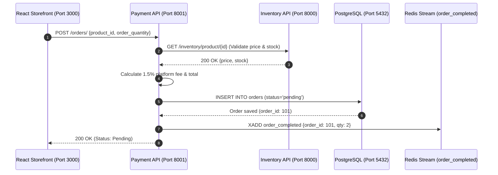

# 💳 Payment & Orders Microservice

The **Payment Microservice** governs order registration, fee and tax computations, relational transaction recording in PostgreSQL, and asynchronous saga choreography across the platform.

---

## ⚡ Technical Specifications

- **Port:** `8001`
- **Framework:** FastAPI (Asynchronous lifespan handlers)
- **Primary Database:** PostgreSQL 16
- **ORM / Data Layer:** SQLModel (SQLAlchemy 2.0 Async) + `asyncpg` connection pooling
- **Message Broker:** Redis Streams (`order_completed` publisher & `refund_order` consumer)
- **Inter-Service Client:** `httpx.AsyncClient` with timeout boundaries

---

## 📂 Folder Structure

```
backend/payment/
├── app/
│   ├── db/
│   │   ├── postgresql.py         # Async engine, connection pool & session dependency
│   │   └── redis_stream.py       # Redis Stream client connection factory
│   ├── models/
│   │   └── models.py             # SQLModel Order table & Pydantic request/response schemas
│   ├── routes/
│   │   └── route.py              # Order lifecycle HTTP endpoints & /health probe
│   ├── services/
│   │   ├── service.py            # Order placement, fee computation & database persistence
│   │   └── stream_service.py     # Redis Stream event publisher (XADD)
│   ├── workers/
│   │   └── consumer.py           # Background refund consumer (refund compensation handler)
│   └── main.py                   # FastAPI application root & lifespan context
└── requirements.txt              # Pinned microservice dependencies
```

---

## 💰 Fee Structure & Tax Architecture

Every order follows this transparent pricing breakdown:

1. **Main Product Price ($P$):** Shelf price (inclusive of 5% GST tax).
2. **Base Price without GST:**
   $$\text{Price}_{\text{excl}} = \text{round}\left(\frac{P}{1.05}, 2\right)$$
3. **Included 5% GST Amount:**
   $$\text{GST} = \text{round}(P - \text{Price}_{\text{excl}}, 2)$$
4. **Platform Fee (1.5%):**
   $$\text{Fee}_{\text{unit}} = \text{round}(0.015 \times P, 2)$$
5. **Grand Total Amount:**
   $$\text{Total} = (P + \text{Fee}_{\text{unit}}) \times \text{Quantity}$$

### Numerical Example ($100 Item, Quantity 2):
- Base Price excl. GST: **$95.24**
- Included 5% GST: **$4.76**
- Main Price incl. GST: **$100.00**
- Platform Fee (1.5%): **$1.50** / unit
- Total Charged: **$203.00**

---

## 🔄 Distributed Choreography Saga Flow



If downstream inventory depletion encounters a stock shortage during asynchronous processing:
1. Inventory worker publishes `refund_order` event.
2. Payment worker consumes `refund_order`.
3. Payment worker executes an atomic SQL update: `UPDATE orders SET status = 'refunded' WHERE order_id = :id`.

---

## 📡 REST API Reference

| Method | Endpoint | Description | Status Codes |
| :---: | :--- | :--- | :--- |
| `GET` | `/health` | Service health probe | `200` |
| `GET` | `/orders/` | Retrieve all orders | `200` |
| `GET` | `/orders/{order_id}` | Retrieve single order details | `200`, `404` |
| `POST` | `/orders/` | Place a new order | `200`, `400`, `404`, `502` |
| `PUT` | `/orders/{order_id}` | Update order status/total via `.returning()` | `200`, `404` |
| `DELETE` | `/orders/{order_id}` | Cancel / remove order record | `200`, `404` |

---

## 🚀 How to Run Locally

From the project root:

```powershell
# 1. Start Payment API (Port 8001 with auto-reload)
npm run dev:payment

# 2. Start Background Refund Consumer (Optional)
npm run dev:payment-worker
```

*Interactive Swagger UI:* [http://localhost:8001/docs](http://localhost:8001/docs)

