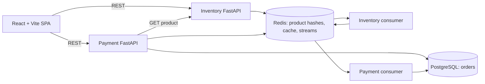
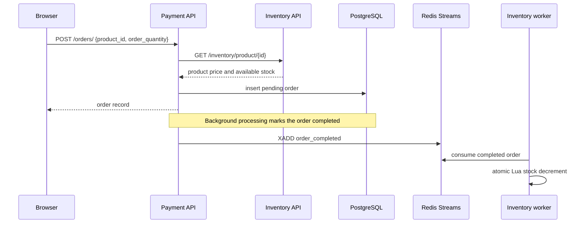

# Inventory Order System Architecture

## Current system

Inventory Order System is a small, event driven commerce demonstration with three kinds of runtime process: a React SPA, two FastAPI services, and two Redis Streams workers. PostgreSQL stores orders. Redis stores inventory hashes, API cache entries, and cross service events.

## Directory map

| Path | Responsibility |
|---|---|
| `frontend/src/App.jsx` | Browser routes: storefront `/`, inventory `/admin`, create `/admin/create`, edit `/admin/edit/:id`, order history `/orders`. |
| `frontend/src/api/client.js` | Fetch wrapper and inventory/payment REST clients. Browser API origins use `VITE_API_URL` and `VITE_PAYMENT_API_URL`. |
| `frontend/src/components/` | Storefront, cart drawer, inventory CRUD, order history, route fallback, and error boundary. |
| `frontend/src/context/CartContext.jsx` | Cart state and localStorage persistence; cart is client-side until an order is submitted. |
| `frontend/src/utils/formatters.js` | Price/date/quantity formatting shared by UI components. |
| `backend/inventory/app/main.py` | Inventory FastAPI app, Redis/cache lifecycle, CORS and health route. |
| `backend/inventory/app/models/` | Redis OM Product model and update input model. |
| `backend/inventory/app/routes/route.py` | Product CRUD HTTP endpoints under `/inventory`. |
| `backend/inventory/app/services/` | Inventory business operations, cache invalidation, stream helpers. |
| `backend/inventory/app/workers/consumer.py` | Reads completed order events and performs atomic stock changes with a Redis Lua script. |
| `backend/payment/app/main.py` | Payment FastAPI app, database initialization, CORS and health route. |
| `backend/payment/app/models/models.py` | SQLModel Order table and request/update schemas. |
| `backend/payment/app/routes/route.py` | Order creation, read, update and delete HTTP endpoints. |
| `backend/payment/app/services/` | Inventory validation, fee/total calculation, order persistence, event publication and processing. |
| `backend/payment/app/db/` | Async SQLAlchemy/PostgreSQL and Redis stream connections. |
| `backend/payment/app/workers/consumer.py` | Processes refund events and updates order state. |
| `docker-compose.yml` | Local Redis, PostgreSQL, APIs, workers and Vite dev server. |
| `tests/` | pytest unit, route, worker integration and end-to-end scenario tests. |

## Request and event flow

An order request is validated against the current inventory response, priced with a 20% fee, persisted as `pending`, and then asynchronously processed. The code uses separate PostgreSQL and Redis operations, so this is eventual consistency and is not an exactly-once transaction. There is no transactional outbox. The UI cart is stored in browser localStorage and does not reserve stock. The inventory worker performs the actual decrement after completion; concurrent orders can therefore encounter stock conflicts after the order was initially accepted.

## API and data boundaries

- Inventory data is stored as Redis OM `Product` hashes. Product list and individual product responses include `id`, name, price, quantity and creation time.
- Order records use an auto-increment integer `order_id` in PostgreSQL and store product id, unit price, fee, total, quantity, status and creation time.
- Payment calls Inventory over HTTP using `INVENTORY_SERVICE_URL`.
- Redis Streams use `order_completed` and `refund_order` stream names. Consumer groups and consumer names are configurable for the inventory worker; defaults are in its module.
- Both APIs expose a basic `/health` endpoint. It reports process health only and currently does not prove database/broker readiness.

## Authentication, state, errors and caching

There is no authentication or authorization middleware. Inventory administration and all order operations are open to any client able to reach the APIs. Do not expose these endpoints publicly as a production commerce service without adding a defined identity/role model and enforcing it server side.

React Router controls page state. Cart items persist in localStorage. Backend endpoints use Pydantic/SQLModel request models and FastAPI's HTTP error responses. The browser fetch client normalizes network and non-2xx failures. Inventory list/product reads use FastAPICache backed by Redis with a 600-second TTL; inventory write operations invalidate relevant cache keys. No other application cache is configured.

## Configuration and deployment shape

`.env.example` lists local host ports, Redis/PostgreSQL settings, service URL, CORS origins, SQL logging toggle, and Vite API URLs. Compose overrides service-to-service hostnames (`redis`, `postgres`, `inventory-api`) for its private network. SQL statement logging is disabled by default; enable `SQL_ECHO=true` only for local debugging because queries can contain application data. Vite `VITE_*` variables are public bundle configuration, never secrets.

The supplied Compose topology is for local development. Its frontend container serves the Vite development server, and the backend services/Redis/PostgreSQL need persistent hosts. No production orchestration, migrations, TLS termination, secret manager, authentication, or Netlify configuration is present.
