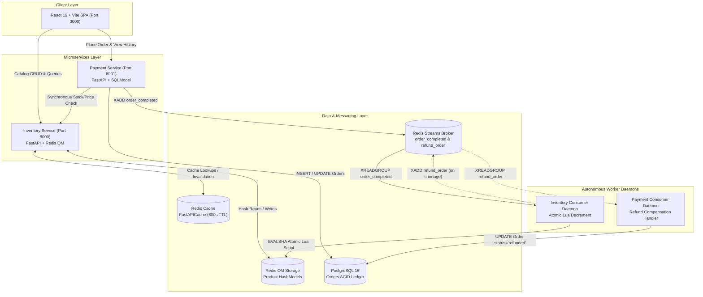

# 🏛️ System Architecture & Engineering Blueprint

This document details the architectural design, distributed transaction patterns, concurrency guarantees, and data boundaries of the **Inventory Order System**.

---

## 1. High-Level System Architecture

The platform separates the **read-heavy product catalog domain** from the **write-heavy, ACID-dependent order processing domain** into two loosely coupled microservices communicating via HTTP and asynchronous Redis Streams:



---

## 2. Microservice Domain Boundaries

| Feature | Inventory Service | Payment Service |
| :--- | :--- | :--- |
| **Primary Domain** | Catalog management, categories, real-time stock | Order creation, fee calculation, transaction ledger |
| **Port** | `8000` | `8001` |
| **Framework** | FastAPI (Async lifespan) | FastAPI (Async lifespan) |
| **Storage Engine** | Redis OM (`Product` Hashes) | PostgreSQL 16 via SQLModel & `asyncpg` |
| **Access Pattern** | 99% Reads, sub-millisecond in-memory lookups | Write-heavy, transactional durability |
| **Concurrency Control** | Redis single-threaded atomic Lua scripts | Relational transactions, row constraints |
| **Caching** | `fastapi-cache2` (Cache-Aside, 600s TTL) | None (orders are strictly transactional) |

---

## 3. Concurrency Architecture: Eliminating Overselling

In flash sales or high-volume e-commerce, multiple clients attempt to purchase the same inventory simultaneously. 

### The Problem: Check-Then-Act Race Condition
If application code reads stock from a database, validates it in Python, and then issues a separate update query:
1. Shopper A reads stock = `1`.
2. Shopper B reads stock = `1` before Shopper A writes.
3. Shopper A updates stock to `0`.
4. Shopper B updates stock to `0` (or `-1`).
5. **Result:** 2 items sold, only 1 was in stock (Overselling / oversell bug).

### The Solution: Redis Atomic Lua Scripting
Redis is single-threaded for command execution. By encapsulating both the stock inspection and decrement into a Lua script, the entire operation runs **indivisibly**:

```lua
local current = redis.call('HGET', KEYS[1], 'quantity')
if not current then
    return -2 -- Product not found
end
local stock = tonumber(current)
local requested = tonumber(ARGV[1])
if stock >= requested then
    redis.call('HSET', KEYS[1], 'quantity', stock - requested)
    return stock - requested -- Returns remaining quantity on success
else
    return -1 -- Insufficient stock error code
end
```
No concurrent read or write can interleave during the execution of this script, guaranteeing **strict zero-overselling**.

---

## 4. Distributed Choreography Saga Pattern

When placing an order across distributed boundaries, standard two-phase commit (2PC) creates blocking dependencies. Instead, this system implements an **Asynchronous Choreography Saga**:

```
[Customer Checkout]
       |
       v
(Payment API) --- INSERT status='pending' ---> [PostgreSQL]
       |
       +--- XADD order_completed ---> [Redis Stream]
                                             |
                                             v
                                  (Inventory Consumer)
                                             |
                                 [Execute Lua Decrement]
                                        /         \
                         Stock Available?         Stock Depleted?
                               /                           \
                             YES                            NO
                             /                                \
                 [XACK order_completed]            [XADD refund_order]
                 [Order marked Completed]                   |
                                                            v
                                                    (Payment Consumer)
                                                            |
                                                   [UPDATE Order status='refunded']
                                                   [XACK refund_order]
```

### Event Compensation Mechanics
1. **Happy Path:** The stock is available. The Lua script decrements stock in Redis, and the message is acknowledged (`XACK`).
2. **Compensation Path:** If stock was exhausted by a competing order, the Lua script returns `-1`. The Inventory Consumer catches this and publishes a `refund_order` event. The Payment Consumer picks up this event and updates the order status to `refunded`.

---

## 5. Crash Recovery & Resilience: Redis Streams PEL

A critical failure mode in event-driven systems occurs when a worker process crashes mid-execution after reading an event but before finishing the decrement or acknowledging the message.

To prevent message loss:
1. **Consumer Groups:** Messages are read using `XREADGROUP`, which automatically assigns messages to a consumer and places them into the **Pending Entries List (PEL)**.
2. **`XACK` Acknowledgement:** The message is only acknowledged *after* the atomic decrement has succeeded.
3. **Startup Auto-Claim (`XAUTOCLAIM`):**
   ```python
   # On worker startup, reclaim messages unacknowledged for > 10,000ms
   reclaimed = await redis.xautoclaim(stream_key, group_name, consumer_name, min_idle_time=10000)
   ```
   If a consumer dies unexpectedly, the next worker to start up will claim the orphaned messages and finish processing them.

---

## 6. Caching Architecture & Cache-Aside Strategy

The Inventory Service uses **FastAPICache** backed by Redis:
- **List Cache:** `/inventory/products` is cached under `inventory.products` with a 600-second TTL. Pipelined batch queries eliminate $N+1$ roundtrip latency.
- **Item Cache:** `/inventory/product/{pk}` is cached under `inventory.product:{pk}` with a 600-second TTL.
- **Invalidation Strategy:** Any state-mutating operation (`POST /inventory/product`, `PUT /inventory/product/{pk}`, `DELETE /inventory/product/{pk}`) invalidates both the item cache and list cache namespaces using `FastAPICache.clear()`.

---

## 7. Frontend Architecture (React 19)

- **Entry & Routing:** React Router 7 provides client-side routing with clean URL navigation:
  - `/` &mdash; Customer Storefront with category pills, live stock badges, and quick-view modal.
  - `/admin` &mdash; Administrative inventory table with instant search and category display.
  - `/admin/create` &mdash; New product registration form with validation.
  - `/admin/edit/:id` &mdash; Product update form.
  - `/orders` &mdash; Real-time order tracking with status badges (`Pending`, `Completed`, `Refunded`).
- **State Management:** `CartContext.jsx` manages shopping cart state with reactive totals and synchronizes with `localStorage`.
- **Fault Tolerance:** A global `ErrorBoundary.jsx` catches unexpected component rendering exceptions and presents a recovery fallback.
